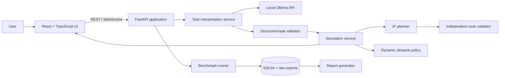
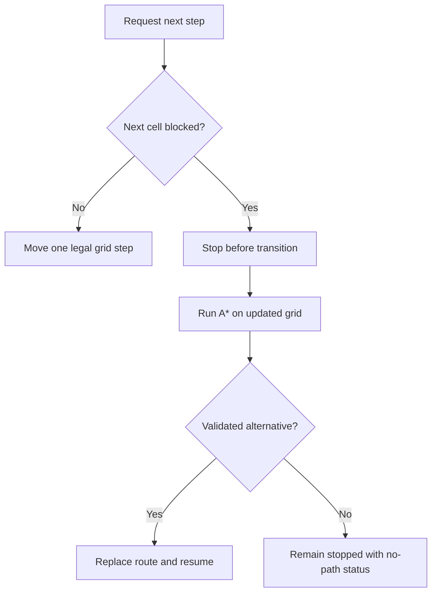

# Robot Navigation FYP — Master Project Documentation

> **Document status:** Living project knowledge base  
> **Last updated:** 2026-10-26 (Asia/Karachi)  
> **Application version:** 0.1.0 — active development  
> **Evidence rule:** `VERIFIED` means a command or test has produced supporting evidence. `IMPLEMENTED, UNVERIFIED` means source exists but has not yet passed its intended checks. `PLANNED` means it does not yet exist.

This is the single authoritative human-readable guide and development record for the project. Supporting files under `docs/` provide concise review views, but their essential information is also maintained here.

## 1. Project introduction

**Official FYP title:** “Cost Effective Optimization of Open Source LLM Agents for System Level Task”

**Assigned workstream:** “Robot Planning Agent – Autonomous 2D Robot Navigation Simulator”

**Implemented direction:** a professional interactive 3D presentation backed by a conventional two-dimensional occupancy grid. The 3D view improves demonstration and interaction; it does not replace the original research requirement for reproducible grid coordinates, obstacles, and deterministic path planning.

### Problem statement

People naturally describe goals in language, while robots need precise, validated instructions. A language model can interpret phrases such as “reach the far goal and avoid the restricted area,” but it is not a safe or reproducible path planner. This project separates those responsibilities: a local open-weight language model translates supported language into a structured task, and an independently tested A* algorithm computes and validates the legal route.

### Central research question

How effectively can freely usable, locally runnable open-weight language models translate natural-language navigation requests into valid structured tasks, and how much can prompt design, strict validation, caching, and avoiding unnecessary inference improve system-level performance without reducing correctness?

### Objectives and expected outcomes

1. Provide an interactive 3D navigation arena that non-technical viewers can operate.
2. Implement real A* planning and an independent route validator.
3. Detect route-blocking map changes and safely replan without another language-model call.
4. Integrate configurable local Ollama models for structured task interpretation.
5. Compare baseline and optimized configurations using real, repeatable measurements.
6. Persist raw evidence and generate understandable exports and a research report.
7. Remain useful in offline development mode when Ollama or models are unavailable.

### Scope boundaries

- The logical world is a finite `(x, z)` grid with four-directional movement in version 1.
- The project is a research simulator, not a controller for physical hardware.
- No paid endpoint, hosted fallback, cloud GPU, or fabricated benchmark observation is allowed.
- The language model interprets intent; it never supplies the authoritative movement route.

## 2. Requirements and acceptance principles

### Essential functional requirements

- 3D grid, robot, start, goal, static/dynamic obstacles, planned route, explored cells, coordinate feedback, camera controls, and direct map editing.
- Validated four-directional A*, clear invalid/no-path outcomes, deterministic random seeds, and measurable planning statistics.
- Play, pause, resume, step, reset, speed, current position, and route progress controls.
- Safe replanning before entering a newly blocked cell; no re-inference for ordinary obstacle changes.
- Local Ollama health/model checks, strict structured task schema, timeout/error handling, and manual fallback.
- At least three verified practical model configurations if hardware/storage testing supports them.
- Sequential baseline/optimized experiments with correctness, latency, route, resource, cache, and failure metrics.
- SQLite history plus JSON/CSV data exports and an evidence-based HTML/PDF report.
- Automated tests covering planning, validation, replanning, LLM failures, caching, APIs, storage, exports, and historical reopening.

### Non-functional requirements

- All project-specific files, environments, caches, packages, models, results, reports, logs, and temporary build data must stay under `D:\Robot_Navigation_FYP`.
- Rendering must remain independent from inference and benchmark work.
- Interfaces must be accessible, restrained, clear to beginners, and honest about readiness and errors.
- Tests use fixed fixtures/seeds; failed experiments remain visible.
- Dependencies remain local and architecture remains modular.

### Current acceptance summary

The complete checklist is tracked in `docs/acceptance-criteria.md`. As of this update, project storage, the D:-based Python environment, static checks, deterministic A*, route validation, and the first safe-replanning behavior are verified.

## 3. Environment and D: storage policy

### Verified initial audit — 2026-10-26

| Item | Observed value | Evidence status |
|---|---|---|
| Project drive | D: (`PYTHON DRIVE D:`) | VERIFIED |
| D: total / free | 465.76 GB / 405.47 GB | VERIFIED |
| Existing project | `D:\Robot_Navigation_FYP` did not exist | VERIFIED |
| D:-based Python | `D:\Miniconda3\python.exe`, Python 3.13.5 | VERIFIED |
| Project venv | `D:\Robot_Navigation_FYP\.venv`, Python 3.13.5, pip 25.1.1 | VERIFIED |
| Node / npm | Node 24.19.0; npm 11.17.0 (existing tools on C:) | VERIFIED |
| Git | 2.53.0.windows.3 (existing Codex runtime on C:) | VERIFIED |
| Ollama | No executable found on `PATH` | VERIFIED |
| Operating system | Windows 10 Home 64-bit, 10.0.19045 | VERIFIED |
| Processor | Intel Core i5-6200U @ 2.30 GHz, 2 cores / 4 logical processors | VERIFIED |
| Memory | 7.86 GB total; 1.36 GB free during final audit | VERIFIED point-in-time |
| Graphics | Intel HD Graphics 520, 1 GB reported adapter RAM, driver 31.0.101.2111 | VERIFIED |

### Estimated storage before installation

- Source, evidence, logs, and normal reports: less than 1 GB.
- Python environment/cache: about 0.5–1.5 GB.
- Frontend dependencies/cache/builds: about 0.5–1.5 GB.
- Three small quantized Ollama models: approximately 3–8 GB, subject to verified tags.
- Model pulls require a safety margin; the application will refuse a pull without the model estimate plus at least 5 GB free.

### Project-scoped redirection

`scripts/project-env.ps1` sets these variables for the current PowerShell process and its children:

| Variable | D: location |
|---|---|
| `PIP_CACHE_DIR` | `.cache\pip` |
| `npm_config_cache` | `.cache\npm` |
| `npm_config_prefix` | `.cache\npm-prefix` |
| `XDG_CACHE_HOME` | `.cache\xdg` |
| `HF_HOME` | `.cache\huggingface` |
| `TEMP`, `TMP` | `.tmp` |
| `PYTHONPYCACHEPREFIX` | `.cache\pycache` |
| `OLLAMA_MODELS` | `models\ollama` |
| result/report/data variables | project result, report, and data directories |

This script does not alter machine-wide environment variables. It must be dot-sourced before setup, launch, model pull, benchmark, and build commands:

```powershell
Set-Location D:\Robot_Navigation_FYP
. .\scripts\project-env.ps1
```

Existing Node and Git executables reside on C: because they were already installed system/runtime components. They are used only as executables; project packages, caches, and outputs are redirected to D:. Ollama installation has not been attempted. If its runtime cannot safely be installed on D:, that exact unavoidable usage will be documented before installation, while model storage will remain on D: through `OLLAMA_MODELS`.

## 4. Architecture



### Responsibility rule

The language model may identify an objective, coordinates explicitly mentioned by the user, movement preference, and supported constraints. It may not invent map facts or decide the final route. The simulation service asks A* to plan; the independent validator checks every returned cell and transition. The frontend only visualizes and interpolates authoritative backend state.

### Main data flow

1. A user selects or edits a map and submits an instruction.
2. FastAPI validates the HTTP request.
3. If Ollama mode is enabled and ready, the task service sends a versioned prompt to one selected local model.
4. The returned JSON is parsed and validated against the task schema and current map.
5. The deterministic simulation service calls A* with the validated start, goal, and obstacles.
6. The independent validator checks the full path.
7. Backend state and metrics are returned; the 3D view animates the logical path.
8. If a new obstacle blocks the next transition, movement stops, A* replans on the changed grid, and movement resumes only after validation.
9. Benchmark runs store raw responses, validation outcomes, timings, planner metrics, failures, and configuration metadata.

## 5. Technology choices

| Technology | Purpose and reason | Status |
|---|---|---|
| Python 3.13 venv | Backend, planning, benchmarking; available from D: and easy to test | VERIFIED environment |
| FastAPI 0.162.0 + Pydantic 2.14.1 | Typed REST/WebSocket API and structured validation | VERIFIED installed in D: venv |
| React 19 + TypeScript 5.9 + Vite 7 | Maintainable interactive browser UI with fast local builds | VERIFIED build |
| Three.js 0.180 / React Three Fiber 9 | Efficient 3D scene and camera lifecycle in React | VERIFIED in browser |
| SQLite / SQLAlchemy 2.1.6 | Local persistent history without a service | VERIFIED installed in D: venv |
| HTTPX 0.28.1 | Async Ollama REST calls with explicit timeouts | VERIFIED installed in D: venv |
| Ollama | Required zero-inference-cost local model runtime | Not installed/detected |
| pytest 9.1.1 + Ruff 0.17.2 | Deterministic tests and static quality checks | VERIFIED installed and run |

Alternatives rejected at this stage include cloud APIs (cost/privacy violation), microservices/containers (unnecessary weight), and using the LLM for routes (unsafe and irreproducible). Diagonal movement is postponed because four-directional movement is easier to explain, validate, and compare academically.

## 6. Folder structure

```text
D:\Robot_Navigation_FYP\
|-- .venv\                         D:-local Python virtual environment
|-- .cache\                        pip/npm/XDG/Hugging Face/bytecode caches
|-- .tmp\                          project-scoped temporary files
|-- backend\
|   |-- planning\                  grid, A*, metrics, independent validation
|   |-- simulation\                authoritative movement and safe replanning
|   |-- api\                       typed request/response schemas and session registry
|   |-- config.py                  D:-based runtime settings
|   `-- main.py                    FastAPI routes and middleware
|-- frontend\                      React/TypeScript/3D client (pending)
|-- tests\                         automated deterministic tests
|-- experiments\
|   |-- scenarios\                 versioned reproducible scenario definitions
|   `-- results\                   raw benchmark evidence
|-- models\ollama\                 required Ollama model-storage target
|-- reports\                       generated report output
|-- logs\                          project logs
|-- scripts\project-env.ps1        session-scoped D: storage configuration
|-- docs\                          concise supporting requirement/design views
|-- pyproject.toml                 backend dependency and tooling definition
`-- PROJECT_MASTER_DOCUMENTATION.md authoritative project guide and history
```

## 7. Deterministic planning implementation

### Grid model — `backend/planning/grid.py`

`GridMap` stores width, depth, and occupied `(x, z)` cells. Dimensions are bounded from 2 to 200 to prevent invalid or accidentally excessive workloads. `in_bounds`, `is_blocked`, and `is_traversable` express the map rules. `neighbours` yields only legal four-directional cells. Obstacle editing rejects out-of-grid and protected cells.

### A* — `backend/planning/astar.py`

`AStarPlanner.plan(grid, start, goal)` uses a priority queue. For each candidate cell:

- `g(n)` is the number of moves from the start.
- `h(n)` is Manhattan distance: `abs(x-goal_x) + abs(z-goal_z)`.
- `f(n) = g(n) + h(n)` determines priority.

Manhattan distance never overestimates a four-directional path without negative costs, so it is admissible. The planner records explored cells, expanded-node count, path length, and elapsed planning milliseconds. It returns explicit `success`, `invalid`, `no_path`, or `invalid_route` status rather than using exceptions for normal planning outcomes.

Example: from `(0,0)` to `(4,0)` without obstacles, the shortest length is four moves. If `(1,0)` through `(3,0)` are blocked, A* must move to the neighbouring row and back, producing a six-move path.

### Independent route validation — `backend/planning/validator.py`

`validate_route` does not trust successful planner completion. It checks that the route is non-empty, starts and ends correctly, keeps every cell in bounds and unblocked, and uses Manhattan distance exactly 1 between consecutive cells. The first invalid index and a readable reason are returned.

## 8. Authoritative simulation and dynamic replanning

`backend/simulation/engine.py` defines `SimulationEngine`. It owns the logical robot position, goal, current route, route index, status, replan count, and recent event history.

`step()` first inspects the next route cell. If that cell has become blocked, it records a stop event without moving, runs A* from the current position on the updated grid, validates the result, and resumes only when an alternative exists. If none exists, status becomes `no_path` and position remains safe. `add_dynamic_obstacle` protects the robot's current position and goal. This flow deliberately contains no LLM call.



The current source is **VERIFIED** by Ruff and 13 automated tests. The measured backend coverage at this milestone is 89%. This percentage is a test-coverage observation, not a claim that 89% of the entire final product exists.

## 9. LLM integration

Status: **IMPLEMENTED AND MOCK-VERIFIED; LIVE RUNTIME UNAVAILABLE**. Ollama is not detected and no model has been downloaded.

`backend/llm/client.py` calls the local `POST /api/chat` endpoint with `stream=false`, `temperature=0`, seed 42, a Pydantic JSON schema in `format`, and a short keep-alive. It records wall, total, load, prompt-token, and generated-token observations when returned by Ollama. The result is validated through `NavigationTask`; malformed output raises a distinct response error. Local transport failures become an explicit 503 at the API boundary.

`backend/llm/prompts.py` versions the baseline and compact prompts. `backend/llm/schemas.py` defines the exact structured contract. It supports explicit start/goal, `navigate` versus `unsupported`, shortest/safe/unspecified preference, named avoid areas, replan preference, and required clarification reasons. `OllamaClient` normalizes equivalent whitespace/case and keys its cache by instruction, model, and prompt version; prompt version changes therefore invalidate cached interpretations.

The current Ollama documentation was checked on 2026-10-26. It confirms that `/api/chat` accepts a JSON schema as `format`, recommends Pydantic schema validation and temperature 0, and reports total/load/evaluation timing and token counts. `/api/tags` returns installed-model names, sizes, digests, parameter size, and quantization. Sources: `https://docs.ollama.com/capabilities/structured-outputs`, `https://docs.ollama.com/api/chat`, and `https://docs.ollama.com/api/tags`.

### Verified candidate catalogue (not installed)

| Tag | Official listed size/context | Why selected | Readiness |
|---|---:|---|---|
| `qwen3:0.6b` | 523 MB / 40K | Smallest candidate; useful low-resource baseline | Not installed |
| `gemma3:1b` | 806 MB / 32K | Compact text model designed for resource-limited devices | Not installed; needs Ollama 0.6+ |
| `smollm2:1.7b-instruct-q4_K_M` | about 1.1 GB / 8K | Explicit instruction-tuned Q4 variant | Not installed |

Official model pages were inspected at `ollama.com/library/qwen3`, `ollama.com/library/gemma3`, and `ollama.com/library/smollm2/tags`. Licence summaries in the catalogue are advisory; exact bundled metadata will be recorded after each real pull. A model is shown as installed only when its exact tag appears in `/api/tags`, and it will not be called benchmark-ready until a real structured inference succeeds.

## 9A. Backend API implementation

`backend/main.py` exposes the first verified service layer:

- `GET /health` reports application version, offline mode, D:-based data/result/report paths, and current D: free space.
- `POST /api/v1/plan` validates a grid/start/goal request and returns the A* route, explored cells, validation result, node count, path length, timing, and status.
- `POST /api/v1/simulations` creates an isolated in-memory simulation and performs its initial plan.
- `GET /api/v1/simulations/{id}` returns authoritative state.
- `POST /api/v1/simulations/{id}/actions` handles plan/play/pause/step/reset.
- `POST /api/v1/simulations/{id}/obstacles` adds/removes a validated obstacle.

`backend/api/schemas.py` contains the Pydantic boundary models. Duplicate obstacles, invalid grid dimensions, bad action names, and malformed coordinates are rejected before business logic. `backend/api/registry.py` maintains UUID-keyed sessions behind a lock. This registry is intentionally temporary; experiment results will use SQLite and simulation persistence will be considered separately.

## 10. Benchmarking, optimization, persistence, and reporting

Status: **IMPLEMENTED AND AUTOMATED-TESTED; REAL MODEL EXPERIMENT PENDING**.

- Baseline: documented full prompt, no response cache, ordinary validation, one eligible inference per task.
- Optimized: shorter prompt, deterministic normalization, schema-aware parsing, cache keyed by normalized input + model + prompt version + relevant map/task inputs, and avoided redundant inference.
- Models run sequentially; cold/warm behavior is labelled.
- Every failure remains in raw results and denominators.
- SQLite stores metadata; JSON and CSV preserve portable evidence.
- HTML/PDF reports use stored evidence only. With no completed benchmark, reports say “no results yet.”

`backend/storage/models.py` defines experiments and benchmark-result rows. `ExperimentRepository` creates, completes, lists, retrieves, and exports them through `backend/data/experiments.db`. Each observation can store model and prompt version, scenario and repetition, interpretation/route/success flags, wall and Ollama durations, token counts, cache hit, route metrics, memory observation, raw response, and failure reason.

`backend/benchmarking/runner.py` iterates models, prompt modes, scenarios, and repetitions strictly sequentially. Each item performs a structured interpretation, compares it with scenario expectations, runs A*, validates the route, records memory and timing, and persists either the evidence or the exact failure. `manager.py` runs the experiment in a background asyncio task while `/api/v1/benchmarks/jobs/{id}` exposes status. Two versioned scenarios currently live under `experiments/scenarios/`.

`backend/reporting/generator.py` builds self-contained HTML and A4 PDF reports from repository records. Summary success rate keeps failures in the denominator; latency ignores missing observations rather than treating them as zero. JSON and UTF-8 CSV provide raw inspection. The PDF was rendered through Poppler and visually checked; the one-page no-results template has clear margins, headings, and no clipping or overlap.

## 11. User interface and 3D simulator

Status: **CORE SIMULATOR VERIFIED; RESEARCH SECTIONS PARTIAL**.

The React client is under `frontend/`. `App.tsx` owns the editable start, goal, obstacle set, API session, playback speed, runtime status, errors, and navigation shell. `components/Arena3D.tsx` renders the tiled grid, lightweight block obstacles, route markers, goal ring, and robot. `api.ts` is the only HTTP boundary. `types.ts` mirrors authoritative API state.

The desktop information architecture contains Overview, 3D Simulator, Model Laboratory, Benchmark Studio, Results & Analysis, Research Report, and Settings & Help. The non-simulator screens currently state that no verified evidence exists and route the user back to the simulator; they do not show fake widgets or results.

Verified controls: orbit/zoom, obstacle/start/goal editing modes, route calculation, play, pause, single step, reset, speed, status, robot position, path progress, replan count, and recent system event. The browser test rendered a 14 × 10 arena, advanced the route, paused, moved exactly one step, inserted obstacles through WebGL tile clicks, and triggered one safe replan when the next cell was blocked. The robot remained at `(9,3)` for the replan tick and received a replacement eight-step route. Visual evidence is stored at `reports/ui-verification.png`.

## 12. Setup, run, test, and stop instructions

These instructions reflect only what currently exists.

### Open the configured environment

```powershell
Set-Location D:\Robot_Navigation_FYP
. .\scripts\project-env.ps1
```

### Recreate the current virtual environment if needed

```powershell
D:\Miniconda3\python.exe -m venv D:\Robot_Navigation_FYP\.venv
D:\Robot_Navigation_FYP\.venv\Scripts\python.exe -m pip --version
```

### Install current backend and development dependencies

```powershell
. .\scripts\project-env.ps1
.\.venv\Scripts\python.exe -m pip install --disable-pip-version-check -e '.[dev]'
```

### Run current static checks and tests

```powershell
. .\scripts\project-env.ps1
.\.venv\Scripts\python.exe -m ruff check backend tests
.\.venv\Scripts\python.exe -m pytest -q --cov=backend --cov-report=term-missing
```

### Start and stop the application

```powershell
Set-Location D:\Robot_Navigation_FYP
.\scripts\run.ps1
# Open http://127.0.0.1:5173
.\scripts\stop.ps1
```

`run.bat` is a double-clickable wrapper for `scripts/run.ps1`. The launcher starts hidden local processes, records their exact PIDs under `.tmp`, and writes stdout/stderr to `logs/`. The stop script checks that each PID still belongs to the expected project command before stopping it.

### Health and troubleshooting

```powershell
.\scripts\health-check.ps1
Get-Content .\logs\backend.err.log
Get-Content .\logs\frontend.err.log
```

If Ollama is absent, remain in offline mode. After installing a compatible runtime, pull only one approved model at a time:

```powershell
.\scripts\pull-model.ps1 -Model 'qwen3:0.6b'
```

That script refuses unknown tags, checks estimated size plus a 5 GB D: safety margin, and inherits `OLLAMA_MODELS=D:\Robot_Navigation_FYP\models\ollama`.

## 13. How to modify or extend the system

This section will grow with implementation. At present:

- Change grid dimension policy in `GridMap.min_size` / `max_size` in `backend/planning/grid.py`, then update boundary tests.
- Change movement rules only by updating `GridMap.neighbours`, the heuristic/cost model, the validator transition rule, methodology, and tests together.
- Add planner statistics through `PlanResult` in `backend/planning/models.py`; do not compute authoritative planner metrics in the UI.
- Add simulation actions through `SimulationEngine`; visual animation must remain a consumer of snapshots rather than a source of logical position.

Model, scenario, prompt, benchmark, and UI extension instructions will be added when those modules actually exist.

- **Add a model:** add one `ModelCandidate` in `backend/llm/catalog.py`, add it to the `ValidateSet` and size map in `scripts/pull-model.ps1`, verify the official tag/licence/size, pull it, run a structured readiness inference, then include it in experiments.
- **Add a scenario:** create a JSON file matching `BenchmarkScenario` under `experiments/scenarios/`; give it a unique versioned ID, fixed map/start/goal, instruction, and expected structured task. Run tests before benchmarking.
- **Change a prompt:** edit `backend/llm/prompts.py` and increment the relevant version. Never reuse a version string after semantic changes because it is part of the cache/evidence key.
- **Change benchmark settings:** use the Benchmark Studio or `POST /api/v1/benchmarks` with one to four installed model tags, prompt modes, scenario IDs, and 1-20 repetitions.
- **Extend the UI:** add typed API contracts in `frontend/src/types.ts`, HTTP calls in `api.ts`, and isolated views/components. Keep authoritative navigation logic on the backend.

## 14. Current development status

### Completed and verified

- Full primary specification and supplemental documentation requirement read.
- D: free space checked before downloads or package installation.
- Project root and storage/cache/result/model/temp directory structure created on D:.
- Local Git repository initialized on D:.
- Project-scoped D: environment configuration created.
- D:-based Python virtual environment created and verified.
- Requirements, architecture, decisions, criteria, targets, and methodology drafted.
- Backend/development dependencies installed inside the D: venv using the D: pip/temp cache policy.
- Ruff passes for current backend/tests.
- Current suite passes: 28 tests. The final coverage run measured 87% across the expanded backend.
- Grid model, A*, independent validation, and safe replanning verified by those tests.
- FastAPI health, planning, simulation lifecycle, duplicate-obstacle, missing-session, and protected-cell behavior verified.
- React/TypeScript frontend dependencies installed under D:, type-check passed, and Vite production build generated under `frontend/dist`.
- 3D UI and playback/replanning workflow verified in a real local browser session.
- Ollama schema/API contracts and three low-resource candidates verified from official sources.
- LLM parsing, malformed-output, unavailable-runtime, cache hit, normalization, and prompt-version invalidation behavior verified with automated mocks.
- SQLite history, versioned scenario loading, sequential baseline/optimized runner structure, JSON/CSV exports, and HTML/PDF reporting verified.
- Overview, Model Laboratory, Benchmark Studio, Results, Research Report, and Settings screens connected to live API state and browser-checked.
- Windows setup/run/stop/health/model-pull scripts parse successfully.
- Final D: audit verified venv, site-packages, pip/npm caches, temp, reports, and Ollama model target.

### In progress

- Delivery archive and final Git snapshot.

### Pending because external runtime/models are absent

- Install Ollama without violating the D:-storage policy, pull candidates sequentially, and run readiness inference.
- Execute real multi-model baseline/optimized benchmarks and derive evidence-supported findings/charts.
- Measure sustained browser FPS and perform before/after optimization on this laptop.

### Blocked

- Real LLM benchmarking is blocked by missing Ollama runtime and model files. The application, offline simulator, deterministic tests, mock-verified LLM contract, storage, export, and reporting remain usable.

## 15. Chronological development log

### 2026-10-26 — Environment inspection and storage gate

- **Files inspected:** two user-supplied master requirement text files.
- **Commands executed:** prompt read, D: capacity query, runtime discovery, Python/Node/npm/Git version checks, Ollama path discovery, initial hardware query.
- **Actual results:** D: had 405.47 GB free; no existing project; D:-based Python 3.13.5 available; Node/npm/Git available; Ollama not on `PATH`.
- **Issue:** formatted OS/CPU/GPU fields were blank in the first combined query.
- **Decision:** repeat hardware discovery later with another output form; do not invent values.
- **Storage estimate:** 2–4 GB excluding models and about 3–8 GB for three small model files, leaving a large safety margin.

### 2026-10-26 — Project structure and D:-only policy

- **Files created:** `.gitignore`, `.env.example`, `scripts/project-env.ps1`, six supporting design/requirement documents, `docs/task-checklist.md`, project directories, and a local Git repository.
- **Work completed:** pip, npm, XDG, Hugging Face, temp, Python bytecode, results, report, and Ollama model locations redirected under the project for configured processes.
- **Safety:** no system-wide environment variables were changed; no dependencies or models were downloaded first.

### 2026-10-26 — Python environment

- **Command:** `D:\Miniconda3\python.exe -m venv D:\Robot_Navigation_FYP\.venv` with project temp/cache variables active.
- **Actual result:** `D:\Robot_Navigation_FYP\.venv\Scripts\python.exe` reported Python 3.13.5 and pip 25.1.1 from the venv's D: site-packages.
- **Issue:** the first long command returned no visible output at its timeout boundary, so a separate verification command checked the resulting executable and package path.

### 2026-10-26 — Deterministic core implementation

- **Files created:** `pyproject.toml`; planning grid/models/validator/A* modules; simulation engine; initial planning and simulation tests.
- **Work completed:** deterministic A*, independent validation, simulation snapshots/events, protected obstacle editing, and safe next-cell replanning logic.
- **Tests:** source-level test cases written but not yet run. No passing claim is made.
- **Next step:** install local dependencies, run static checks/tests, fix failures, update this document with exact results.

### 2026-10-26 — Continuous master documentation requirement

- **File created:** `PROJECT_MASTER_DOCUMENTATION.md` at the mandatory path.
- **Decision:** this file is now the authoritative narrative and will be updated before each subsequent major milestone.

### 2026-10-26 — Deterministic-core verification

- **Dependency command:** `python -m pip install --disable-pip-version-check -e '.[dev]'` after dot-sourcing the project environment.
- **Storage evidence:** pip's temporary editable wheel was stored under `D:\Robot_Navigation_FYP\.tmp`; packages were installed in the D: venv. The pip cache was configured under the project's D: `.cache` directory.
- **First static result:** Ruff reported nine style findings: eight over-length lines and one modern import-location issue.
- **First test result:** 12 passed and one failed; coverage was 88%. The failing test showed that `SimulationEngine.step()` replanned and moved in the same tick, making the safety stop unobservable.
- **Root cause and fix:** the engine correctly avoided the blocked cell but immediately used the replacement route. The replan branch now returns its stationary snapshot, consuming one authoritative tick before movement resumes. Lines/imports were also cleaned.
- **Final verification:** Ruff reported `All checks passed!`; pytest reported `13 passed in 0.55s`; measured backend coverage was 89%.
- **Outstanding:** broader branches and API behavior still need tests; this result covers only the current deterministic modules.

### 2026-10-26 — Typed backend API milestone

- **Files created:** `backend/config.py`, `backend/api/schemas.py`, `backend/api/registry.py`, `backend/main.py`, and `tests/test_api.py`.
- **Work completed:** typed health/planning/simulation/obstacle endpoints, UUID session registry, D:-path health evidence, and constrained CORS for the local Vite client.
- **Verification:** Ruff passed. Pytest reported `18 passed` with measured backend coverage of 92%.
- **Warning observed:** Starlette emitted a deprecation warning for its current `TestClient` integration with `httpx`, recommending `httpx2`. This is within a third-party test helper; production HTTP code is unaffected. It remains tracked rather than hidden.
- **Outstanding:** SQLite experiment persistence and an actual process-level server launch check still need implementation/verification.

### 2026-10-26 — 3D frontend build and browser verification

- **Files created:** Vite/TypeScript configuration, frontend package manifest, API/types layer, main application, React Three Fiber arena, and complete styling.
- **Install result:** npm added 132 packages under `frontend/node_modules` using D:-based npm/temp locations. npm reported that esbuild has an install script not yet covered by npm's `allowScripts` policy; no approval or global setting change was made. The available local binary still completed the build.
- **Compile result:** TypeScript type-check passed. Vite produced `frontend/dist/index.html`, CSS, a 1,142,259-byte JS bundle, and source map on D:.
- **Process check:** local Vite returned HTTP 200; Uvicorn health returned version 0.1.0, offline mode, all D: storage paths, and 404.73 GB free.
- **Browser result:** the 3D scene rendered with controls and authoritative metrics. Play advanced from 0/18; pause followed by step advanced exactly once. Tile clicks increased the obstacle count. Blocking next cell `(10,3)` caused one replan, produced an eight-step replacement, and left the robot stationary for the replan tick.
- **Evidence:** `reports/ui-verification.png`.

### 2026-10-26 — Local LLM contract and model catalogue

- **Sources checked:** current official Ollama structured-output, chat, installed-model, and candidate library pages.
- **Files created/modified:** `backend/llm/*`, backend settings/routes, and `tests/test_llm.py`.
- **First check:** the expanded suite passed 23 tests, but Ruff found six formatting issues. These were corrected and Ruff then passed.
- **Automated result:** 23 tests passed; measured backend coverage was 90%. LLM tests use controlled HTTP mocks and therefore do not claim a real local inference.
- **Runtime reality:** Ollama remains unavailable and no candidate is installed, downloaded, or benchmarked.

### 2026-10-26 — Persistence, benchmarking, and reporting

- **Files created:** storage ORM/repository, benchmark scenario/runner/manager/API schemas, two versioned scenarios, report generator, storage/benchmark/report tests, and connected API endpoints.
- **Work completed:** persistent SQLite experiment history, sequential model/configuration/scenario/repetition loops, background jobs, explicit failure recording, JSON/CSV exports, and evidence-based HTML/PDF reports.
- **Verification progression:** 26 tests initially passed with 91% coverage; two unclosed SQLite resource warnings were traced to test repository lifecycles and fixed by disposing engines explicitly. After report and API expansion, 28 tests passed.
- **Honesty rule:** the generated no-results HTML/PDF state that no comparison can be made. No mock observation is stored in the real experiment database or displayed as an LLM result.

### 2026-10-26 — Research UI and safety gating

- **Files modified:** typed frontend API/models plus `ResearchSections.tsx` and research-screen styling.
- **Behavior:** Overview shows live backend/storage/evidence counts; Model Laboratory shows three verified candidates and actual readiness; Benchmark Studio disables execution when Ollama is unavailable; Results shows stored history; Report creates exports from history; Settings displays exact paths.
- **Browser verification:** Model Laboratory visibly showed Ollama unavailable and all three candidates as not installed. Benchmark Studio showed three model checkboxes and its run button was disabled, preventing a misleading benchmark.
- **Build:** TypeScript passed; Vite production build succeeded. Vite warned that the main minified JS chunk is about 1.15 MB (322 KB gzip), so route-level code splitting remains a documented optimization.

### 2026-10-26 — Windows delivery and final storage audit

- **Files created:** `scripts/setup.ps1`, `run.ps1`, `stop.ps1`, `health-check.ps1`, `pull-model.ps1`, `run.bat`, and `README.md`.
- **Hardware result:** Windows 10 Home 64-bit (10.0.19045); Intel Core i5-6200U, 2 cores/4 logical processors; 7.86 GB RAM with 1.36 GB free at inspection; Intel HD Graphics 520 with 1 GB reported adapter memory.
- **Final checks:** all six PowerShell scripts parsed without syntax errors; Ruff passed; pytest reported 28 passed with one known third-party Starlette TestClient deprecation warning; TypeScript passed; Vite built production assets.
- **Launch ownership fixes:** process inspection first showed that `Start-Process npm.cmd` returns a wrapper PID. A repeated-start test then proved that the wrapper can exit while its child Vite process remains alive. The launcher was therefore changed to invoke the project-local `vite.js` entrypoint directly with Node, giving run/stop scripts the real server PID. Repeated start and stop were rechecked after this correction.
- **Path evidence:** Python executable/prefix/site-packages, pip cache, npm cache, temp, generated reports, and Ollama model path all resolved under `D:\Robot_Navigation_FYP`. D: had 404.69 GB free.
- **Reports:** `reports/generated/no-results-report.html` and `.pdf` created. Poppler confirmed one unencrypted A4 PDF page, and PNG inspection found no clipping, overlap, or legibility issue. Poppler printed a non-visual Symbol-font diagnostic; the rendered page was intact.

## 16. Known limitations and honest caveats

- Ollama is not installed/detected. No model is installed, readiness-tested, or benchmarked, so the application contains no model ranking or research finding.
- Real performance optimization claims require completed equivalent baseline/optimized model runs; only deterministic planning examples (roughly sub-millisecond in the verified browser scenario) have been observed.
- Automated coverage is 87% across the current backend; background-job API branches and some failure/control branches need more tests.
- Frontend verification is browser-driven rather than a committed Playwright/Vitest suite.
- Simulation sessions are in-memory and reset on backend restart; experiment history is persistent in SQLite.
- The Vite build reports a large main chunk (about 1.15 MB / 322 KB gzip). Lazy-loaded research sections are a sensible future optimization.
- The application uses a remote Google Fonts CSS import when network is available; system fonts provide a readable fallback offline.
- Existing Node and Git executables are on C: as preinstalled/runtime components. The Codex runtime and the supplied attachments also live on C: outside project control. All intentionally created project dependencies, caches, temp data, source, results, models target, reports, and logs are on D:.
- The known Starlette `TestClient` deprecation warning is from the installed FastAPI/Starlette test helper and does not affect the running API.

## 17. Final delivery record

### Verified deliverables

- Working local FastAPI backend and React/Three.js frontend.
- Interactive 3D grid, editable start/goal/obstacles, A* route, robot playback, safe dynamic replanning, and plain-language state messages.
- Strict local-Ollama adapter, model catalogue/readiness endpoint, versioned prompts, schema validation, failure recovery, and prompt-versioned cache.
- Background sequential benchmark engine, versioned scenarios, SQLite evidence, JSON/CSV export, and HTML/PDF report generation.
- Professional research navigation and truthful empty/unavailable states.
- D:-scoped setup, cache, temp, model, launch, shutdown, health, and model-pull workflow.
- 28 passing backend tests, Ruff pass, TypeScript pass, Vite production build, PowerShell syntax pass, HTTP health checks, and real browser interaction verification.

### Verified output artifacts

- `reports/ui-verification.png`: desktop simulator after browser-level verification.
- `reports/generated/no-results-report.html`: offline self-contained report template.
- `reports/generated/no-results-report.pdf`: visually inspected A4 report template.
- `frontend/dist/`: production frontend build.
- `delivery/Robot_Navigation_FYP_source.zip`: source delivery including documentation, scenarios, production build, and verified reports; excludes venv, caches, temp, node_modules, Git internals, logs, database runtime state, and model files.

### Final readiness boundary

The deterministic research platform is delivered and verified. The dissertation's empirical model-comparison stage is not complete because Ollama/models are absent. The UI and documentation state this explicitly. After installing Ollama, use the guarded pull script, verify each model in Model Laboratory, then run the same scenarios/configurations to populate real findings.

The final local Git history is on branch `main`. The delivery archive was enumerated after creation: 124 entries, 1.59 MB compressed, and zero entries matching the excluded dependency/cache/runtime directories.

