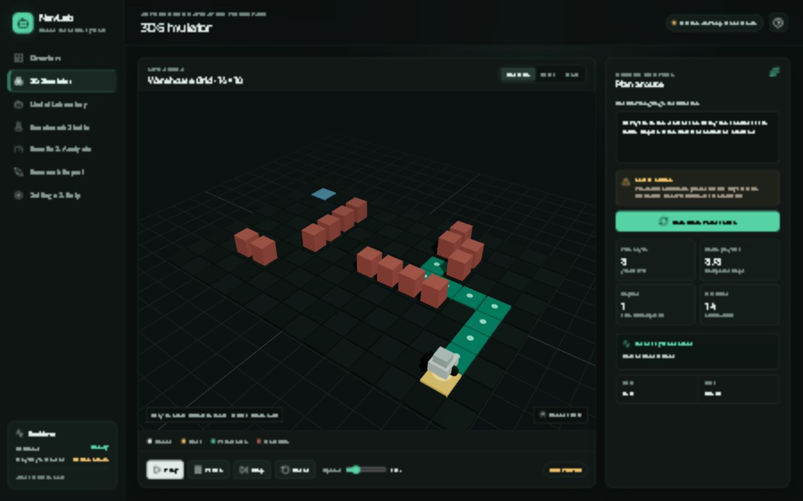

# NavLab — Local LLM Benchmarking for Safe 3D Robot Navigation

NavLab is a Windows-first research platform that evaluates how small, freely licensed local language models interpret natural-language robot-navigation instructions. The model translates the request into a strict task schema; it never controls motion. Deterministic A*, independent route validation, and a backend-authoritative simulator decide every movement.



## Why this project matters

Real robots need both flexible human instructions and predictable safety controls. A language model can understand phrases such as “take the shortest safe route” or “avoid the central corridor,” but generative output should not be trusted as the motion planner. NavLab demonstrates a practical hybrid architecture:

1. A local LLM interprets human intent into validated structured data.
2. Deterministic A* calculates a legal route.
3. An independent validator checks every cell and transition.
4. The simulator stops before a newly blocked transition and replans without asking the LLM again.
5. Benchmarks preserve successes, failures, latency, tokens, cache behavior, route metrics, and raw responses.

This pattern is relevant to warehouse robots, indoor delivery platforms, inspection systems, assistive robots, educational robotics, and research into safe human-robot interfaces. More broadly: use the model for intent, while keeping execution under deterministic, testable controls.

## Features

- Interactive React Three Fiber warehouse with orbit/zoom controls.
- Editable start, goal, and static/dynamic obstacles.
- Four-directional A* with Manhattan heuristic and independent route validation.
- Play, pause, step, reset, speed, progress, events, and replan metrics.
- Safe dynamic-obstacle behavior: stop first, then replan.
- Local Ollama inference with no paid API.
- Frontend switching between three installed models.
- Strict Pydantic task schema, deterministic normalization, and versioned prompts.
- Baseline versus optimized sequential benchmarking.
- SQLite experiment history and raw-response retention.
- Evidence-derived analytics plus JSON, CSV, HTML, and PDF exports.
- D:-scoped Python environment, caches, packages, models, builds, logs, data, and reports.
- Deterministic offline mode when the LLM runtime is unavailable.

## Architecture

```text
Natural-language instruction
          │
          ▼
Selectable local Ollama model
          │ structured task only
          ▼
Pydantic schema + deterministic normalization
          │
          ▼
Backend simulation ──► A* planner ──► route validator
          │
          ├── dynamic obstacle policy
          ▼
React + TypeScript + Three.js visualization

Benchmark runner ──► SQLite ──► analytics ──► JSON / CSV / HTML / PDF
```

The central rule is: **the LLM may interpret a task, but it may not generate or authorize the robot route.**

## Technology stack

| Layer | Technology |
|---|---|
| Frontend | React 19, TypeScript, Vite, Three.js, React Three Fiber, Drei |
| Backend | Python, FastAPI, Uvicorn, Pydantic |
| Planning | Deterministic four-directional A* and independent validation |
| Local AI | Project-local Ollama 0.40.11 |
| Models | Qwen2.5 0.5B, Qwen3 0.6B, SmolLM2 1.7B Instruct Q4 |
| Persistence | SQLite through SQLAlchemy |
| Reports | ReportLab, self-contained HTML, JSON, CSV |
| Quality | pytest, Ruff, TypeScript compiler, Vite production build |

## Approved models

The exact installed bundles were checked with `ollama show --license` and reported Apache License 2.0:

| Model | Purpose | Official page |
|---|---|---|
| `qwen2.5:0.5b` | Small structured-output baseline | [Ollama](https://ollama.com/library/qwen2.5:0.5b) |
| `qwen3:0.6b` | Newer compact Qwen comparison | [Ollama](https://ollama.com/library/qwen3:0.6b) |
| `smollm2:1.7b-instruct-q4_K_M` | Larger instruction-tuned Q4 comparison | [Ollama](https://ollama.com/library/smollm2:1.7b-instruct-q4_K_M) |

No cloud inference service or paid model API is required.

## Quick start on the verified PC

```powershell
Set-Location D:\Robot_Navigation_FYP
.\scripts\run.ps1
```

Open http://127.0.0.1:5173. Stop project-managed services with:

```powershell
.\scripts\stop.ps1
```

## Full setup on a new PC

Use [AI_AGENT_NEW_PC_SETUP.md](AI_AGENT_NEW_PC_SETUP.md). It is a self-contained prompt and deployment runbook covering prerequisites, libraries, storage rules, official links, checksums, model installation, verification, browser acceptance, and troubleshooting.

Condensed setup:

```powershell
Set-Location D:\Robot_Navigation_FYP
. .\scripts\project-env.ps1
.\scripts\setup.ps1 -IncludeReportDependencies
.\scripts\install-ollama.ps1
.\scripts\run.ps1
.\scripts\pull-model.ps1 -Model 'qwen2.5:0.5b'
.\scripts\pull-model.ps1 -Model 'qwen3:0.6b'
.\scripts\pull-model.ps1 -Model 'smollm2:1.7b-instruct-q4_K_M'
.\scripts\health-check.ps1
```

Large machine-specific payloads are intentionally reproduced on the target PC rather than stored in ordinary Git: `.venv`, `node_modules`, caches, Ollama runtime archives/binaries, model blobs, logs, and temporary files. The repository contains the source, lockfiles, pinned download/checksum scripts, evidence database, benchmark exports, reports, and all instructions required to recreate them. Secrets are never committed.

## Using NavLab

1. Open **3D Simulator**.
2. Choose an installed model from **Local LLM model**.
3. Enter a navigation instruction and click **Interpret and plan route**.
4. Review model latency, tokens, parsed intent, and the independently validated route.
5. Use Play/Pause/Step/Reset or edit the map to test replanning.
6. Use **Benchmark Studio** for sequential baseline/optimized experiments.
7. Use **Results & Analysis** for factual aggregates and experiment history.
8. Use **Research Report** for JSON, CSV, HTML, and PDF exports.

## Verified reference experiment

The included experiment contains 24 real observations: three models × two prompt modes × two scenarios × two repetitions.

| Model | Baseline task match | Optimized task match | Optimized mean wall time* |
|---|---:|---:|---:|
| Qwen2.5 0.5B | 0/4 | 4/4 | 7,228 ms |
| Qwen3 0.6B | 0/4 | 4/4 | 5,711 ms |
| SmolLM2 1.7B Q4 | 0/4 | 4/4 | 14,738 ms |

All 24 deterministic routes passed validation. Baseline interpretation failures remain in the evidence and include invented coordinates/areas, incorrect preferences, and unnecessary clarification.

\* Each optimized mean includes two validated cache hits recorded as zero wall time. With only two scenarios and two repetitions per group, this is a system demonstration and observed configuration—not a general model ranking.

Reference artifacts:

- `experiments/results/ad5f9bb6-bb44-43af-8926-847361f5ab62/results.json`
- `experiments/results/ad5f9bb6-bb44-43af-8926-847361f5ab62/results.csv`
- `reports/generated/ad5f9bb6-bb44-43af-8926-847361f5ab62/research-report.html`
- `reports/generated/ad5f9bb6-bb44-43af-8926-847361f5ab62/research-report.pdf`

## Test and build

```powershell
. .\scripts\project-env.ps1
.\.venv\Scripts\python.exe -m ruff check backend tests
.\.venv\Scripts\python.exe -m pytest -q

Set-Location .\frontend
npm run typecheck
npm run build
```

Verified release: Ruff passes, 28 backend tests pass, TypeScript passes, and Vite builds successfully. Vite reports a non-fatal large-chunk advisory for the Three.js application.

## Storage policy

All project-created source, virtual-environment files, packages, dependency caches, temporary data, frontend dependencies/builds, Ollama runtime/model payloads, logs, experiment evidence, and reports are stored under `D:\Robot_Navigation_FYP` on the working installation.

Ollama requires `%USERPROFILE%\.ollama`; on the verified PC this is a Windows junction targeting `D:\Robot_Navigation_FYP\.ollama-home`. Existing Windows, Node, Git, and Codex components are not relocated unsafely.

See [the final storage audit](docs/final-storage-audit.md) and [model/runtime evidence](docs/model-license-evidence.md).

## Documentation

- [New-PC AI-agent handoff](AI_AGENT_NEW_PC_SETUP.md)
- [Authoritative project documentation](PROJECT_MASTER_DOCUMENTATION.md)
- [Requirements](docs/requirements.md)
- [Architecture](docs/architecture.md)
- [Methodology](docs/methodology.md)
- [Acceptance criteria](docs/acceptance-criteria.md)
- [Performance targets](docs/performance-targets.md)
- [Model and licence evidence](docs/model-license-evidence.md)
- [Final storage audit](docs/final-storage-audit.md)

## Research integrity

- No fabricated benchmark results.
- Failed responses remain in raw evidence and denominators.
- Raw model output is retained.
- Cached and uncached timings are labelled.
- Deterministic tests are not presented as model measurements.
- Results are scoped to exact hardware, models, scenarios, prompts, and repetitions.

## Large files, secrets, and licensing

GitHub blocks ordinary Git files larger than 100 MB, and machine-specific environments/caches are not portable. This repository therefore does not redistribute model blobs, the Ollama runtime archive, `.venv`, `node_modules`, caches, logs, or secrets. Guarded scripts download approved payloads from official sources directly to D: and verify the pinned runtime checksum. Review every third-party licence before redistribution or commercial deployment.
